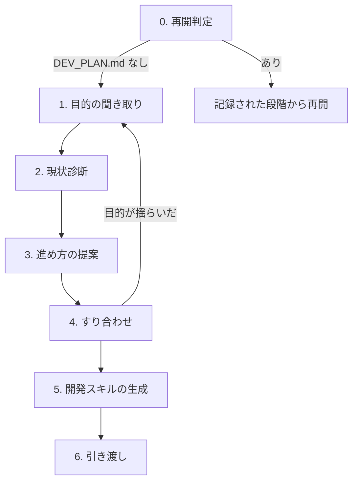

# AI駆動開発

開発の目的ごとに、AI に任せる進め方を決め、それを専用のスキルにして渡すスキル。特定の作業の手順は持たない。持つのは、目的を聞き取る手順、出典つきのベストプラクティスのカタログ、合意した進め方をスキルに落とす手順の3つ。

失敗しやすいのは、(1) 目的を聞かずにいつもの進め方を当てはめる、(2) 出典の無い「ベストプラクティス」を自信ありげに勧める、(3) カタログを全部盛りにして、小さな仕事に重い手順を背負わせる、の3つ。このスキルは、聞き取り→診断→提案→合意を必ず通し、提案の各項目に出典の ID を付けることでこれを防ぐ。

## ワークフロー



| ノード | 入力 | 出力 | 委任 |
|---|---|---|---|
| 1. 目的の聞き取り | 依頼、`references/goal-interview.md` | `DEV_PLAN.md` の目的の節 | — |
| 2. 現状診断 | 対象リポジトリ | `DEV_PLAN.md` の現状診断の節 | — |
| 3. 進め方の提案 | `DEV_PLAN.md`、`references/practice-catalog.md` | 提案表 | — |
| 4. すり合わせ | 提案表、ユーザーの回答 | 合意済みの `DEV_PLAN.md` | — |
| 5a. 生成 | `DEV_PLAN.md` | 開発スキルのディレクトリ | — |
| 5b. レビュー | 生成したスキル、`DEV_PLAN.md` | 指摘一覧 | サブエージェント |
| 6. 引き渡し | 生成したスキル | 報告 | — |

作業ファイルは対象の直下の `ai-dev/` に置く。リポジトリがまだ無ければ作業フォルダの直下に作る。

| ファイル | 役割 | 正本の形式 |
|---|---|---|
| `ai-dev/DEV_PLAN.md` | 工程とセッションをまたぐデータ契約。目的・診断・提案・合意・生成の記録 | `assets/templates/DEV_PLAN.md` |
| `ai-dev/REVIEW_LOG.md` | ユーザーのレビューの指摘と、それへの対応の台帳。すり合わせはこの台帳で進める | `assets/kits/review-log/REVIEW_LOG.md` |

**作業はローカルで行い、コミットも push もしない。** 対象が git リポジトリなら、`ai-dev/` を `.git/info/exclude` に足して誤コミットを防ぐ。権限で書けなければ、足す1行をユーザーに示して頼み、先へ進む。

本文の `scripts/`・`references/`・`assets/` はこのスキルのディレクトリから見たパス。

## 手順

### 0. 再開判定

対象の直下に `ai-dev/DEV_PLAN.md` があれば、「状態」の行を読み、`check_review_log.py` で `ai-dev/REVIEW_LOG.md` の残りの指摘を出してから、どこから再開するかを宣言する。ユーザーの回答済みの項目はもう一度聞かない。

| 状態 | 再開する場所 |
|---|---|
| `聞き取り中` | 手順1の、目的の節で埋まっていない項目から |
| `提案中` | REVIEW_LOG に未対応・確認待ちがあれば手順4でその対応から。無ければ最新の節への回答を待つ |
| `合意済み` | 手順5。生成先にスキルの途中までがあれば、検査から |
| `生成済み` | 手順6。引き渡しの報告がまだなら報告する。済んでいれば、スキルの見直しの依頼かを確かめる |

### 1. 目的の聞き取り

`references/goal-interview.md` を読んでから聞く。

1. 依頼文・会話・対象のリポジトリ（README、AGENTS.md、既存の計画）から分かることを先に埋める。読めば分かることは質問しない
2. 埋まらない項目を、手戻りの大きい順に1回3件まで、推奨の答えと理由を添えて質問する。往復は3回まで。残った項目は「未決」として `DEV_PLAN.md` に書き、推奨の答えを仮置きする
3. `assets/templates/DEV_PLAN.md` を `ai-dev/DEV_PLAN.md` に、`assets/kits/review-log/REVIEW_LOG.md` を `ai-dev/REVIEW_LOG.md` にコピーする。目的の節を埋め、状態を `聞き取り中` にする

**完了条件: 目的・成功の判定・繰り返しの頻度・使う AI ツール・人が判断したい場面の5項目が、回答か「未決（仮置き）」で埋まっていること。**

### 2. 現状診断

1. `python scripts/survey_repo.py <対象ディレクトリ>` を実行し、出力を `DEV_PLAN.md` の現状診断の節に貼る
2. 出力で分からないこと（テストが実際に通るか、触ってはいけない箇所、遅いビルド）は、README・AGENTS.md・CI の設定を読んで足す。テストのコマンドが分かれば実行し、通ったか・何秒かかったかを書く
3. 新規開発でリポジトリが無ければ、「リポジトリなし」と書いてこの手順を終える

**完了条件: 現状診断の節に、スクリプトの出力と、テストを実行したかどうか（実行したなら結果）が書かれていること。**

### 3. 進め方の提案

`references/practice-catalog.md` を読み、目的と現状診断に照らして選ぶ。

1. 「広く勧められている」段（A）の項目は、合わない理由が無いかぎり採用候補にする。外すときは理由を書く
2. 「条件付き」段（C）の項目は、カタログの「合う場面」に当てはまるものだけを候補にする。当てはまらないものは提案に入れない
3. 「注意すべき知見」段（N）から、この目的に関係するものを1〜2件添える
4. 次の形の提案表を `DEV_PLAN.md` に書く。会話で示すときは、`assets/kits/review-log/references/review-presentation.md` の形にし、`REVIEW_LOG.md` に R1 の節を足す。会話に表の全行を貼らない。判断が要る行（採否が分かれる、トレードオフが大きい）だけを5つまで推奨つきで示し、残りは「ほか N 件は推奨どおり採用の案。全文は `ai-dev/DEV_PLAN.md`」と件数とパスで示す

```markdown
| # | プラクティス | 採否の案 | この目的での理由 | トレードオフ・代わりの案 | 出典 |
|---|---|---|---|---|---|
| A1 | 検証手段を渡す | 採用 | テストが 42 件あり 8 秒で通る | — | S1, S2, S10 |
| C1 | spec 駆動 | 採用しない | 1人で数日の改修。仕様書のレビューの手間が見合わない | 大きな機能だけ A7 の聞き取り→仕様で代える | S6, S8 |
```

5. 表とは別に、**任せる範囲**（どの作業を AI に任せ、どれを人が主導するか）と、**効果の確かめ方**（何を数えて、AI に任せた効果を判断するか）を1〜3行ずつ提案する

出典の無い項目を勧めない。カタログに無い工夫を足すときは、出典の列に「推測」と書き、そう判断した理由を添える。

**完了条件: 提案表・任せる範囲・効果の確かめ方を会話で示し、`REVIEW_LOG.md` に依頼の節があり、状態を `提案中` にしたこと。**

### 4. すり合わせ

1. ユーザーの指摘・質問・採否の判断を、受け取るたびに `ai-dev/REVIEW_LOG.md` に1行ずつ書く（書き方は台帳の冒頭と `review-presentation.md`）。対応したら状態と対応内容を更新する。会話だけで済ませない。直したものをもう一度見せるときは、新しい節を足し「前回からの変更」に指摘の ID ごとの変更箇所を書く
2. 回答に合わせて、提案表の採否を1件ずつ確定する。迷っている項目には、推奨と理由をもう一度短く示す
3. 生成するスキルの仕様を決める。決めるのは次の5つで、どれも推奨の答えを添えて聞く
   - 名前: kebab-case。推奨は `<対象>-dev`（例 `inventory-app-dev`）
   - 置き場所: 推奨は対象リポジトリの `.agents/skills/<名前>/`。Codex・Copilot・Antigravity CLI がそのまま読む。Claude Code は `.claude/skills` にリンクを張る必要があり、その手順は引き渡しで伝える。個人のスキル置き場に置く案もある
   - 発火の言い回し: ユーザーがその開発で実際に言いそうな依頼を3〜5個
   - 使う既存スキル: 計画の詰め、レビュー、実機確認など、手元にあるスキルのうち使うもの
   - 記録とコミットの扱い: 推奨は「ローカルで作業し、ユーザーのレビューを REVIEW_LOG に残しながら進める。コミットしない」。コードはユーザーが望めばタスクごとにコミットしてよい。設計書などの文書はこまめにコミットしない
4. 目的そのものが揺らいだ（作るものが変わった、成功の判定が変わった）ら、手順1に戻るかをユーザーに確認する
5. 往復は3回まで。決まらない項目は推奨の答えで仮置きし、「未決」として残す

**完了条件: 提案表の全行の採否と生成スキルの仕様が `DEV_PLAN.md` にあり、`python assets/kits/review-log/scripts/check_review_log.py ai-dev/REVIEW_LOG.md` が終了コード 0（未対応なし）で、ユーザーから「これで作って」の合意を得て、状態を `合意済み` にしたこと。** 合意前にスキルを生成しない。

### 5. 開発スキルの生成

1. **`workflow-skill-architect` が使えるなら、それに従って作る。** `DEV_PLAN.md` を設計の入力にし、ステップ1の聞き取りは `DEV_PLAN.md` で済んだものとして扱う。使えなければ、`assets/templates/generated-SKILL.md` をコピーして埋める
2. 採用したプラクティスを、カタログの「生成スキルへの入れ方」の列に従って、工程・完了条件・禁止事項・検査スクリプトに落とす。採用しなかったものは入れない
3. カタログで部品が用意されているもの（レビュー記録、タスク台帳ループ）は、`assets/kits/` から写す。写し方は、タスク台帳ループは部品の `SKILL-steps.md` の冒頭のコメント、レビュー記録は `assets/kits/review-log/` の中身を、REVIEW_LOG.md は生成スキルの assets/templates 直下へ、review-presentation.md は references 直下へ、check_review_log.py は scripts 直下へ写す。レビュー記録（K2）は、ユーザーが外すと決めないかぎり必ず入れる
4. 生成したスキルの検査をする。`workflow-skill-architect` の検証スクリプト（validate_skill.py）が使えるなら、それを終了コード 0 になるまで回す。使えなければ、name がディレクトリ名と一致する・description に何をするかといつ使うかがあり200字以内・本文から参照されないファイルが無い、の3点を自分で確かめる
5. **レビューはサブエージェントに渡して実行する。** 渡すのは生成したスキルのディレクトリと `DEV_PLAN.md` のパスだけにし、「合意した採否とスキルの中身が食い違う箇所、初見で推測が要る箇所を列挙して」と頼む。結果が返るまで生成物を書き換えずに待つ。返った指摘は `REVIEW_LOG.md` の「S<回> 自己レビュー」の節に ID `S1-1` の形で書き、ユーザーの指摘（R）と混ぜない。サブエージェントが使えない環境では、`DEV_PLAN.md` の採否の表を1行ずつ、生成したスキルのどこに入ったかを指で追って確かめる
6. 評価ケースを2〜3件、生成したスキルの `evals/evals.json` に置く（代表の依頼1〜2件と、発火させない依頼1件）。形式は `workflow-skill-architect` のステップ7と同じ

**完了条件: 検査が通り、レビューの指摘への対応を `ai-dev/REVIEW_LOG.md` に書き、`check_review_log.py` が終了コード 0 で、状態を `生成済み` にしたこと。** 検査とレビューの往復は3回まで。超えたら残った指摘を添えてユーザーに相談する。

### 6. 引き渡し

ユーザーに次を報告する。

- 生成したスキルの場所と、呼び出し方（発火の言い回しの例）
- `ai-dev/DEV_PLAN.md` と `ai-dev/REVIEW_LOG.md` の場所（すり合わせの経緯はここにある）
- Claude Code で使うなら、リンクの張り方（`.claude/skills` から `.agents/skills` へ。README の「チーム展開への移行」と同じ手順）
- 採用したプラクティスと採用しなかったもの、それぞれの理由（`DEV_PLAN.md` の表の要約）
- 効果の確かめ方。何回か使ったら、数えた結果を持って見直しを頼んでほしいと伝える
- コミットはしていないこと。コミットするかはユーザーが決める

**完了条件: 報告を示したこと。**

## 終了条件と失敗時の扱い

- 成功: 生成したスキルの検査が通り、引き渡しの報告をした
- 上限: 聞き取り・すり合わせは各3往復、生成の検査とレビューは3周
- 打ち切り: ユーザーが「もう十分」と言ったら、未決の項目を推奨の答えで仮置きして次の工程に進み、仮置きしたことを報告に書く
- 想定外: 目的が開発ではない（資料作成、調査だけ）と分かったら止めて、別のスキル（`markdown-doc`、`notebooklm` など）が合うかをユーザーに確認する

## 禁止事項

- 目的を聞き取らずに提案すること、合意前にスキルを生成すること
- 出典の ID も「推測」の表示も無いプラクティスを勧めること
- カタログの項目を、目的との照合なしにまとめて採用すること
- ユーザーの AGENTS.md・既存のスキルを、頼まれずに書き換えること
- 生成したスキルや `ai-dev/` の作業ファイルを、頼まれずにコミット・push すること
- ユーザーの指摘を `REVIEW_LOG.md` に書かずに反映すること、未対応を残したまま次の工程に進むこと

## 参照ファイル

| ファイル | 読むタイミング |
|---|---|
| `references/goal-interview.md` | 手順1で、聞き取りを始める前 |
| `references/practice-catalog.md` | 手順3で提案を作るとき、手順5で採用したものをスキルに落とすとき |

## テンプレートと部品

| ファイル | 使うとき |
|---|---|
| `assets/templates/DEV_PLAN.md` | 手順1。`ai-dev/DEV_PLAN.md` にコピーして埋める |
| `assets/kits/review-log/` | 手順1で `REVIEW_LOG.md` をコピーする。手順5で生成するスキルに写す（K2） |
| `assets/templates/generated-SKILL.md` | 手順5で `workflow-skill-architect` が使えないとき |
| `assets/kits/task-ledger/` | 手順5で、タスク台帳ループ（カタログの K1）を採用したとき |

## スクリプト

```
python scripts/survey_repo.py <対象ディレクトリ> [--json]
python assets/kits/review-log/scripts/check_review_log.py <REVIEW_LOG.md のパス>
```

手順2で使う。言語の内訳（スキル置き場の `.agents/skills` などは除き、既存のスキルとして別に数える）、ビルド・パッケージの定義、テストファイルの有無、CI、lint の設定、エージェント向け文書（AGENTS.md・CLAUDE.md など）、既存のスキル、git の状態を集め、Markdown の表（`--json` なら JSON）で出す。ファイルの中身は package.json の scripts と pyproject.toml の `[tool.*]` の見出しだけを読む。標準ライブラリのみ。終了コードは 0 が成功、2 が引数の誤り（ディレクトリでない）。

`check_review_log.py` は手順0・4・5で使う。レビュー記録の表を読み、状態が「未対応」「確認待ち」の行（指摘の冒頭つきで1件1行）、「対応済み」で対応が空の行、「見送り」で理由が空の行を ERROR にする。ID が〔〕のままの雛形の行は数えない。終了コードは 0 が未対応なし（指摘0件も含む）、1 が未対応か不備あり、2 が引数の誤り・ファイルが読めない・表が見つからない。生成するスキルには部品ごと写す。

部品の `assets/kits/task-ledger/scripts/check_ledger.py` の使い方は、部品の `SKILL-steps.md` の末尾にある。
