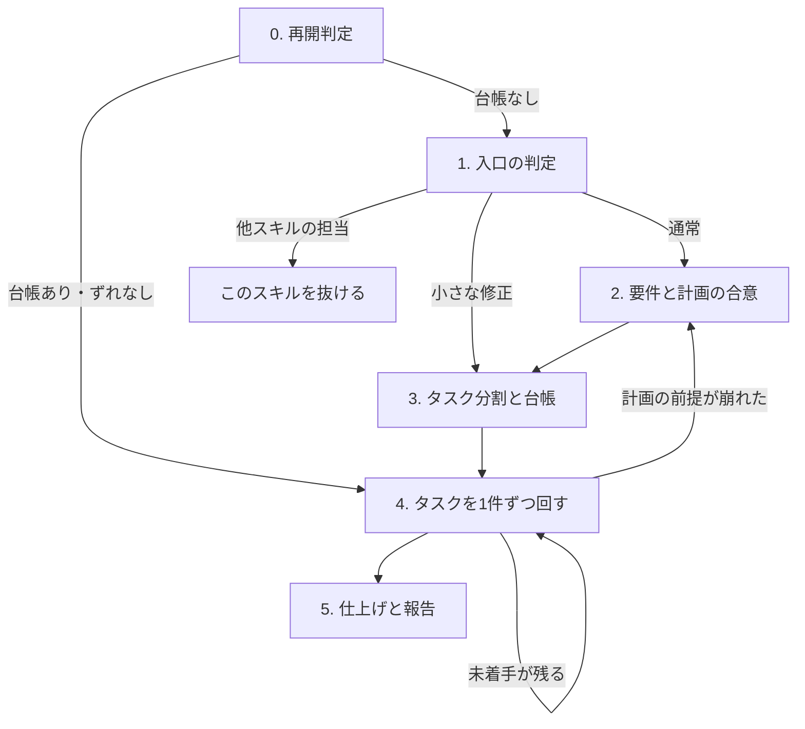

# AI駆動開発

要件の合意からコミットまでを、AI が小さな単位で確実に回すための進行役スキル。計画の詰め、レビュー、実機確認などは既存のスキルに任せ、このスキルはそれらを**どの順で呼び、何をもって次へ進むか**だけを決める。

AI に開発を任せたときの失敗は、だいたい次の4つに集まる。(1) 大きな変更を一度に書き、どこで壊れたか分からなくなる。(2) テストを走らせずに「できました」と言う。(3) テストを消したり期待値を書き換えたりして通す。(4) 頼まれていない箇所まで直す。このスキルはタスク台帳と検査スクリプトでこの4つを塞ぐ。

## ワークフロー

外側は直列の4工程、手順4の中に1タスクずつのループがある。



| ノード | 入力 | 出力 | 委任 |
|---|---|---|---|
| 0. 再開判定 | `DEV_TASKS.md`、git の状態 | 再開位置 | — |
| 1. 入口の判定 | 依頼文、リポジトリ | 進め方（通常 / 小さな修正 / 他スキル） | — |
| 2. 要件と計画の合意 | 依頼、関連コード | 合意済みの計画（目的・範囲外・受け入れ条件） | — |
| 3. タスク分割と台帳 | 計画、検証コマンド | `DEV_TASKS.md` | — |
| 4a〜4c. 実装と検証 | 台帳の1行 | コード、テスト、証拠 | — |
| 4d. レビュー | 差分、台帳の1行、`references/review-criteria.md` | 指摘一覧 | サブエージェント |
| 4e. コミット | 差分、証拠 | コミット、台帳の更新 | — |
| 5. 仕上げ | 台帳 | `check_ledger.py` の結果、報告 | — |

台帳 `DEV_TASKS.md` がセッション間・工程間のデータ契約になる。形式は `assets/templates/DEV_TASKS.md` が正本。本文の `scripts/`・`references/`・`assets/` はこのスキルのディレクトリから見たパスで、台帳の `DEV_TASKS.md` は作業リポジトリ直下を指す。

## 手順

### 0. 再開判定

作業リポジトリ直下に `DEV_TASKS.md` があれば再開とみなす。

1. 台帳を読み、`git branch --show-current`・`git status --short`・`git log --oneline 開始コミット..HEAD` を実行する（開始コミットは台帳の「作業環境」節にある）
2. `python scripts/check_ledger.py DEV_TASKS.md --repo . --resume` を実行する。`--resume` は未着手・進行中を ERROR にせず、完了タスクの証拠とコミットの実在だけを見る。終了コード 0 なら台帳の記録に不備はない
3. 次の3点がそろえば、ずれなしとする
   - 現在のブランチが台帳の「ブランチ」と同じ
   - `開始コミット..HEAD` のコミットが、台帳の「コミット」列にすべて載っている
   - `git status --short` に出るのが `DEV_TASKS.md` と、「進行中」タスクの変更だけ
4. ずれなしなら、「進行中」のタスク、無ければ先頭の「未着手」から再開すると宣言して手順4に入る。「進行中」のタスクに未コミットの変更が残っていれば、差分の要約を示し、続きから進めるか捨てて4aからやり直すかをユーザーに確認する
5. **ずれていたら（ブランチが違う、台帳にないコミットがある、進行中タスクと無関係な変更がある）、作業を始めずにずれをユーザーに報告して指示を待つ**

`HANDOFF.md` もあれば先に読む（`session-handoff` の再開の手順）。台帳と食い違うときは git の実際の状態を正とし、食い違いをユーザーに報告する。

### 1. 入口の判定

| 状況 | 進め方 |
|---|---|
| 新機能・複数ファイルにまたがる変更・仕様の解釈が要る | 通常（手順2から） |
| 原因の分かっている1か所の修正で、既存のテストか新しいテスト1本で確かめられる | 小さな修正。手順2を省く。手順3は台帳の作成と検証コマンドの特定だけ行い、タスクは1行にして了承を待たずに手順4へ |
| 不具合だが原因が分かっていない | 先に原因を突き止める。組込みC++なら `cpp14-defect-analysis`。原因が確定したら小さな修正か通常に合流する |
| 既存コードのレビューだけ・静的解析の仕分けだけ | このスキルは使わない（`cpp14-code-review` などの担当） |
| どれにも当てはまらない | 通常として扱う |

### 2. 要件と計画の合意

1. 関連するコード・設計書・既存のテストを読む。まだ質問しない
2. 計画の草案を書く。入れるのは目的、範囲外（やらないこと）、受け入れ条件（判定できる文）、影響を受けるファイルの見込み
3. `implementation-plan-grill` が使えるなら、草案をそれに通して穴を潰す。使えなければ、前提・スコープ・入出力・依存・エッジケース・失敗時の挙動・検証方法の7観点で未決事項を洗い、手戻りの大きい順に1回3件まで、推奨回答つきで質問する
4. 設計の判断が割れて決めきれないときは、`second-opinion` が使えるなら別系統のAIの意見を取る

**完了条件: 計画をユーザーに示し、「これで進めてよい」の合意を得たこと。** 合意前にコードを書かない。

### 3. タスク分割と台帳

`references/task-splitting.md` を読んでから分ける。

1. **検証コマンドを特定する。** テスト・lint（型検査を含む）・ビルド・起動の各コマンドを、`package.json`・`Makefile`・`pyproject.toml`・CI の設定・README から読み取る。見つからないものは推測で埋めず、ユーザーに尋ねる。テストの仕組み自体が無ければ、それを最初のタスクにする
2. 計画を、**1タスク1コミット**の大きさに分ける。各タスクには判定できる完了条件を付ける（「`test_parse_empty` が通る」「`/health` が 200 を返す」）。依存の順に並べる
3. `assets/templates/DEV_TASKS.md` をコピーして作業リポジトリ直下に `DEV_TASKS.md` として置き、作業環境（ブランチと `git rev-parse --short HEAD` の開始コミット）・目的・受け入れ条件・検証コマンド・タスクを埋める。作業用のブランチが要るなら、開始コミットを記録する前に作る
4. `.git/info/exclude` に `DEV_TASKS.md` の行が無ければ足す。誤ってコミットされるのを防ぎ、`.gitignore` を書き換えずに済む
5. タスク一覧をユーザーに示す

**完了条件: 台帳を作り、タスク一覧にユーザーの了承を得たこと。** 件数が10を超えたら分け方が細かすぎないか見直し、それでも多ければ「最初の数件まで進めて報告する」区切りをユーザーと決める。

### 4. タスクを1件ずつ回す

先頭の「未着手」を1件取り、状態を「進行中」にしてから始める。同時に2件以上を「進行中」にしない。

```
for タスク in 台帳の未着手（依存順）:
    4a. テストを書き、実行して失敗を確認する（RED）
    4b. 実装し、そのテストが通るのを確認する（GREEN）
    4c. 検証コマンドをすべて実行する
        失敗 → 直して 4c をやり直す。同じ失敗が2回続いたら直し方を変える
        失敗の回数が通算3回になったら止めて相談する
    4d. レビュー（サブエージェント）。指摘を直したら 4c からやり直す。レビューは2周まで
    4e. コミットし、台帳を「完了」にして証拠とコミットを書く
    計画の前提が崩れた → ループを抜け、手順2に戻るかをユーザーに確認する
```

失敗の回数は1タスクごとに数え、4c で検証が失敗するたびに1を足す。レビューの指摘を直した後の 4c の失敗も同じ回数に足し、タスクが完了するまで0に戻さない。

**4a. テストを書いて失敗させる。** 完了条件を確かめるテストを先に書いて実行し、**期待した理由で**失敗するのを見る。import エラーや構文エラーでの失敗は RED ではない。確認したら、失敗の内容（例: `AssertionError: 3 != 4`）を台帳の「証拠」列に `RED: ...` として書く。テストで判定できないタスク（画面の見た目、実機、外部サービス）は `references/task-splitting.md` の「テストで判定できないタスク」に従い、代わりの確かめ方を台帳に書いてから進む。

**4b. 実装する。** テストを通す最小限のコードを書き、通った件数を「証拠」列に `GREEN: ...` として足す。タスクの範囲外のファイルに直したい箇所を見つけたら、直さずに台帳へ新しいタスクとして足す。振る舞いを変える変更とリファクタリングを同じタスクに混ぜない。

**4c. 検証する。** 台帳の検証コマンドを全部実行し、結果（通った件数、エラー0件など）を台帳の「証拠」列に足す。起動して確かめられるもの（CLI、サーバー、画面）は実際に起動する。**実行していないコマンドを「通った」と書かない。** 実行できない環境なら「未実行（理由）」と書く。

**4d. レビュー。** レビューはサブエージェントに渡して実行する。渡すのは差分（`git diff`）、台帳の該当行、`references/review-criteria.md` のパスだけにし、実装時の意図や判断の説明は渡さない。結果が返るまでコードを書き換えずに待つ。対象が組込みC++なら、`cpp14-code-review` が使えるならそれに渡す。サブエージェントが使えない環境では、コミット前に差分を他人が書いたものとして読み直し、`references/review-criteria.md` を1項目ずつ当てる。指摘は直すか、直さない理由を台帳の「証拠」列に1行残す。

**4e. コミットする。** 1タスク1コミット。メッセージはリポジトリの規約に従い、無ければ「何を・なぜ」を1行で書く。コミットしたら台帳の状態を「完了」にし、短いハッシュを「コミット」列に書く。

**完了条件（1タスク）: 4a の RED、4b の GREEN、4c の検証結果、4d の対応が証拠列にあり、コミットが記録されていること。**

**ユーザーへの報告:** 1タスクごとの実況はしない。タスクが完了したら台帳の該当行の要約を1〜2行、失敗の連続・方針変更・範囲外の発見はその場で伝える。

### 5. 仕上げと報告

1. 受け入れ条件を1つずつ確かめ、全体の検証コマンドをもう一度実行する
2. `python scripts/check_ledger.py DEV_TASKS.md --repo .` を実行し、終了コード 0 にする
3. ユーザーに報告する。入れるのは、完了・保留・中止のタスクの件数と一覧、受け入れ条件ごとの結果、検証コマンドの結果、保留や中止にしたものの理由。都合の悪い項目を省かない
4. push・プルリクエストは、ユーザーかリポジトリの規約が求めている場合だけ行う
**完了条件: `check_ledger.py` が終了コード 0 で、報告をユーザーに示したこと。** 未着手・進行中が残ったまま完了として報告しない。

**途中で作業を終える場合**（ユーザーが止めた、区切りまで進めた、セッションを閉じる）は、手順5の1〜2を行わない。台帳の状態を実際に合わせ、`check_ledger.py --resume` を終了コード 0 にし、`session-handoff` が使えるなら引き継ぎ書も作る。完了条件は、残りのタスクの件数と次に着手するタスクをユーザーに報告したこと。台帳は消さない。

## 終了条件と失敗時の扱い

- 成功: 台帳の全タスクが「完了」「保留」「中止」のどれかで、`check_ledger.py` が終了コード 0、受け入れ条件をすべて満たした
- 上限: 1タスクの検証の直しは3回、レビューは2周。超えたらそのタスクを止め、試したことと残った失敗を添えてユーザーに相談する
- 収束しない場合: 同じ失敗が2回続いたら同じ直し方をやめ、前提（テストの期待値・仕様の解釈・環境）を疑う。それでも変わらなければ相談する
- 前提が崩れた場合: 計画にない仕様の判断が要る、受け入れ条件どうしが矛盾する、と分かったらループを抜け、手順2に戻るかをユーザーに確認する
- 「保留」「中止」にできるのはユーザーの了承を得たときだけ。理由を「証拠」列に書く

## 禁止事項

- テストを削除・スキップする、期待値を実装に合わせて書き換える、で通すこと。期待値が誤っていると判断したら、変える前にユーザーに確認する
- 実行していない検証を「通った」と台帳や報告に書くこと
- RED を確認せずに実装に入ること（テストで判定できないタスクを除く）
- 複数のタスクを1コミットにまとめること、範囲外のファイルを黙って直すこと
- 合意前にコードを書くこと、ユーザーの了承なくタスクを「保留」「中止」にすること
- 強制 push、履歴の書き換え、ユーザーに頼まれていない push やプルリクエストの作成
- `DEV_TASKS.md` をコミットすること。ユーザーが求めた場合を除く

## 参照ファイル

| ファイル | 読むタイミング |
|---|---|
| `references/task-splitting.md` | 手順3でタスクに分けるとき。手順4aでテストを書けないタスクに当たったとき |
| `references/review-criteria.md` | 手順4dのレビューで。サブエージェントに渡すか、自分で当てる |

## テンプレート

| ファイル | 使うとき |
|---|---|
| `assets/templates/DEV_TASKS.md` | 手順3。作業リポジトリ直下にコピーして埋める |

## スクリプト

```
python scripts/check_ledger.py DEV_TASKS.md [--repo リポジトリのパス] [--resume]
```

台帳のタスク表を読み、状態ごとの件数と不備を出す。標準ライブラリだけで動く。

- 状態は「未着手」「進行中」「完了」「保留」「中止」の5つ（英語の todo / doing / done / hold / dropped も受け付ける）
- 「未着手」「進行中」が残っていれば ERROR。「完了」で証拠かコミットが空、「保留」「中止」で証拠（理由）が空も ERROR
- 「完了」のコミット列は、短いハッシュ（7〜40桁の16進数）を空白かカンマで区切ったものだけを認める
- `--repo` を付けると、「完了」のコミットがそのリポジトリに実在するかを `git cat-file` で確かめ、無ければ ERROR。git リポジトリでないパスを渡したら終了コード 2
- `--resume` を付けると、未着手・進行中を ERROR にせず件数だけ数える（再開時と途中で終えるとき用）
- `〔` を含むセルは未記入として扱う。コードブロックの中の表と、`\|` でエスケープした縦線は読み飛ばす
- 検証コマンドの表が空なら WARN

| 終了コード | 意味 |
|---|---|
| 0 | 全タスクがクローズ済みで、不備なし |
| 1 | 未クローズのタスクか不備がある（`--resume` なしの途中経過の確認で 1 になるのは正常） |
| 2 | 引数の誤り、ファイルが読めない、タスク表が見つからない、`--repo` が git リポジトリでない |
