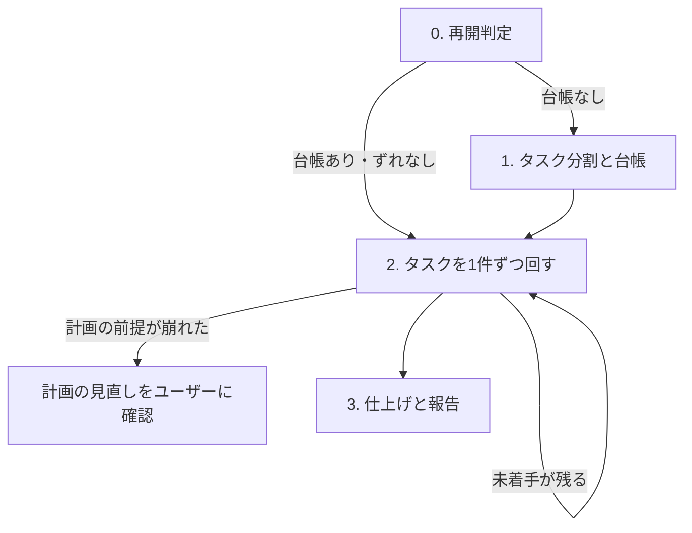

# 部品: タスク台帳ループ

<!-- ai-driven-dev が目的別の開発スキルを生成するときに使う部品。生成するスキルに次のように写す。
     - この本文 → 生成する SKILL.md の手順（目的に合わせて削る・言い換える。工程名・完了条件・禁止事項は残す）
     - DEV_TASKS.md → assets/templates/DEV_TASKS.md
     - references/ → references/（task-splitting.md・review-criteria.md）
     - scripts/check_ledger.py → scripts/check_ledger.py（標準ライブラリのみ。使い方は本文末尾の節）
     本文は既定の「コミットしない」方式で書いてある。ユーザーがコードのコミットを望んだときだけ、
     末尾の「タスクごとにコミットする場合」の差分を当てる。写したらこの HTML コメントを消す。 -->

合意した計画を小さなタスクに分け、1件ずつ「テストを先に書く→実装→検証の証拠→レビュー→区切り」と回す手順。作業はローカルで行い、コミットしない。ユーザーのレビューは `ai-dev/REVIEW_LOG.md` に記録する（部品「レビュー記録」）。

AI に開発を任せたときの失敗は、だいたい次の4つに集まる。(1) 大きな変更を一度に書き、どこで壊れたか分からなくなる。(2) テストを走らせずに「できました」と言う。(3) テストを消したり期待値を書き換えたりして通す。(4) 頼まれていない箇所まで直す。台帳と検査スクリプトでこの4つを塞ぐ。

## ワークフロー



| ノード | 入力 | 出力 | 委任 |
|---|---|---|---|
| 0. 再開判定 | `ai-dev/DEV_TASKS.md`、git の状態 | 再開位置 | — |
| 1. タスク分割と台帳 | 合意した計画、検証コマンド | `ai-dev/DEV_TASKS.md` | — |
| 2a〜2c. 実装と検証 | 台帳の1行 | コード、テスト、証拠 | — |
| 2d. レビュー | そのタスクの差分、台帳の1行、`references/review-criteria.md` | 指摘一覧 | サブエージェント |
| 2e. 区切り | 差分、証拠 | 台帳の更新、区切り | — |
| 3. 仕上げ | 台帳 | `check_ledger.py` の結果、報告 | — |

台帳 `ai-dev/DEV_TASKS.md` がセッション間・工程間のデータ契約になる。形式は `assets/templates/DEV_TASKS.md` が正本。コミットしない（`ai-dev/` は `.git/info/exclude` に入っている前提）。

### 区切り方（コミットしない方式）

タスクごとの差分を見分け、やり直せるようにするため、タスクが完了するたびに区切りを付ける。

- git リポジトリなら、完了したタスクの変更を `git add <変更ファイル>` でステージする。コミットはしない。進行中のタスクの差分は `git diff`（ステージされていない分）、完了済みの全体は `git diff --cached` で見られる。進行中のタスクを捨てるときは `git restore <ファイル>` でステージ済みの状態に戻す
- git リポジトリでなければ、タスクに着手する前に、変更する予定のファイルを `ai-dev/snapshots/<タスクID>/` に写す。差分は写しとの比較で見る

## 手順

### 0. 再開判定

`ai-dev/DEV_TASKS.md` があれば再開とみなす。

1. 台帳と `ai-dev/REVIEW_LOG.md` を読み、`git status --short` を実行する
2. `python scripts/check_ledger.py ai-dev/DEV_TASKS.md --resume --no-commit` を実行する。終了コード 0 なら完了タスクの記録に不備はない
3. 次の2点がそろえば、ずれなしとする
   - ステージ済みの変更ファイルが、台帳の完了タスクの「変更ファイル」列に収まっている
   - ステージされていない変更が、進行中タスクの「変更ファイル」に収まっている（進行中が無ければ、ステージされていない変更が無い）
4. ずれなしなら、進行中のタスク、無ければ先頭の未着手から再開すると宣言する。進行中のタスクに変更が残っていれば、差分の要約を示し、続きから進めるか捨てて 2a からやり直すかをユーザーに確認する
5. **ずれていたら、作業を始めずにずれをユーザーに報告して指示を待つ**

### 1. タスク分割と台帳

`references/task-splitting.md` を読んでから分ける。

1. **検証コマンドを特定する。** テスト・lint（型検査を含む）・ビルド・起動の各コマンドを、`package.json`・`Makefile`・`pyproject.toml`・CI の設定・README から読み取る。見つからないものは推測で埋めず、ユーザーに尋ねる。テストの仕組み自体が無ければ、それを最初のタスクにする
2. 計画を、1回のレビューで差分を読み切れる大きさのタスクに分ける。各タスクに判定できる完了条件を付け（「`test_parse_empty` が通る」）、依存の順に並べる
3. `assets/templates/DEV_TASKS.md` を `ai-dev/DEV_TASKS.md` にコピーし、目的・受け入れ条件・検証コマンド・タスクを埋める
4. タスク一覧をユーザーに示す。見せ方は `references/review-presentation.md`（部品「レビュー記録」）に従い、指摘は `ai-dev/REVIEW_LOG.md` に記録する

**完了条件: 台帳を作り、タスク一覧にユーザーの了承を得たこと。** 件数が10を超えたら分け方が細かすぎないか見直し、それでも多ければ「最初の数件まで進めて報告する」区切りをユーザーと決める。

### 2. タスクを1件ずつ回す

先頭の未着手を1件取り、状態を「進行中」にし、変更する予定のファイルを「変更ファイル」列に書いてから始める。同時に2件以上を進行中にしない。

```
for タスク in 台帳の未着手（依存順）:
    2a. テストを書き、実行して失敗を確認する（RED）
    2b. 実装し、そのテストが通るのを確認する（GREEN）
    2c. 検証コマンドをすべて実行する
        失敗 → 直して 2c をやり直す。同じ失敗が2回続いたら直し方を変える
        失敗の回数が通算3回になったら止めて相談する
    2d. レビュー（サブエージェント）。指摘を直したら 2c からやり直す。レビューは2周まで
    2e. 区切りを付け、台帳を「完了」にする
    計画の前提が崩れた → ループを抜け、計画の見直しをユーザーに確認する
```

失敗の回数は1タスクごとに数え、2c で検証が失敗するたびに1を足す。レビューの指摘を直した後の失敗も同じ回数に足し、タスクが完了するまで0に戻さない。

**2a. テストを書いて失敗させる。** 完了条件を確かめるテストを先に書いて実行し、**期待した理由で**失敗するのを見る。import エラーや構文エラーでの失敗は RED ではない。確認したら、失敗の内容（例: `AssertionError: 3 != 4`）を台帳の「証拠」列に `RED: ...` として書く。テストで判定できないタスク（画面の見た目、実機、外部サービス、リファクタリング）は `references/task-splitting.md` の「テストで判定できないタスク」に従う。

**2b. 実装する。** テストを通す最小限のコードを書き、通った件数を「証拠」列に `GREEN: ...` として足す。範囲外のファイルに直したい箇所を見つけたら、直さずに台帳へ新しいタスクとして足す。振る舞いを変える変更とリファクタリングを同じタスクに混ぜない。

**2c. 検証する。** 台帳の検証コマンドを全部実行し、結果（通った件数、エラー0件など）を「証拠」列に足す。起動して確かめられるもの（CLI、サーバー、画面）は実際に起動する。**実行していないコマンドを「通った」と書かない。** 実行できない環境なら「未実行（理由）」と書く。

**2d. レビュー。** レビューはサブエージェントに渡して実行する。渡すのは、そのタスクの差分（git なら `git diff`、そうでなければ写しとの比較）、台帳の該当行、`references/review-criteria.md` のパスだけにし、実装時の意図や判断の説明は渡さない。結果が返るまでコードを書き換えずに待つ。サブエージェントが使えない環境では、差分を他人が書いたものとして読み直し、`references/review-criteria.md` を1項目ずつ当てる。指摘は直すか、直さない理由を台帳の「証拠」列に1行残す。

**2e. 区切りを付ける。** 「区切り方」に従って区切り、台帳の状態を「完了」にする。コミット列は「なし」と書く。

**完了条件（1タスク）: 2a の RED、2b の GREEN、2c の検証結果、2d の対応が証拠列にあり、区切りが付いていること。**

**ユーザーへの報告:** 1タスクごとの実況はしない。タスクが完了したら1〜2行で伝え、ユーザーに見てほしい区切り（画面が1つできた、機能が1つ通った）でレビューを頼む。失敗の連続・方針変更・範囲外の発見はその場で伝える。

### 3. 仕上げと報告

1. 受け入れ条件を1つずつ確かめ、全体の検証コマンドをもう一度実行する
2. `python scripts/check_ledger.py ai-dev/DEV_TASKS.md --no-commit` を実行し、終了コード 0 にする
3. ユーザーに報告する。入れるのは、完了・保留・中止のタスクの件数と一覧、受け入れ条件ごとの結果、検証コマンドの結果、保留や中止の理由。都合の悪い項目を省かない。変更の全体は `git diff --cached`（または写しとの比較）で見られると伝える
4. 作業を途中で終えるなら、手順3の1〜2は行わず、台帳の状態を実際に合わせて `check_ledger.py --resume --no-commit` を終了コード 0 にし、残りの件数と次に着手するタスクを報告する。`session-handoff` が使えるなら引き継ぎ書も作る

**完了条件: `check_ledger.py` が終了コード 0 で、報告をユーザーに示したこと。** 未着手・進行中が残ったまま完了として報告しない。

## 終了条件と失敗時の扱い

- 成功: 全タスクが「完了」「保留」「中止」のどれかで、`check_ledger.py` が終了コード 0、受け入れ条件をすべて満たした
- 上限: 1タスクの検証の直しは通算3回、レビューは2周。超えたらそのタスクを止め、試したことと残った失敗を添えてユーザーに相談する
- 収束しない場合: 同じ失敗が2回続いたら同じ直し方をやめ、前提（テストの期待値・仕様の解釈・環境）を疑う
- 前提が崩れた場合: 計画にない仕様の判断が要る、受け入れ条件どうしが矛盾する、と分かったらループを抜け、ユーザーに確認する
- 「保留」「中止」にできるのはユーザーの了承を得たときだけ。理由を「証拠」列に書く

## 禁止事項

- テストを削除・スキップする、期待値を実装に合わせて書き換える、で通すこと。期待値が誤っていると判断したら、変える前にユーザーに確認する
- 実行していない検証を「通った」と台帳や報告に書くこと
- RED を確認せずに実装に入ること（テストで判定できないタスクを除く）
- 複数のタスクを1つの区切りにまとめること、範囲外のファイルを黙って直すこと
- ユーザーの了承なくタスクを「保留」「中止」にすること
- 頼まれずにコミット・push すること

## 参照ファイル

| ファイル | 読むタイミング |
|---|---|
| `references/task-splitting.md` | 手順1でタスクに分けるとき。2a でテストを書けないタスクに当たったとき |
| `references/review-criteria.md` | 2d のレビューで。サブエージェントに渡すか、自分で当てる |

## スクリプト

```
python scripts/check_ledger.py ai-dev/DEV_TASKS.md [--no-commit] [--resume] [--repo リポジトリのパス]
```

台帳のタスク表を読み、状態ごとの件数と不備を出す。標準ライブラリだけで動く。

- 状態は「未着手」「進行中」「完了」「保留」「中止」の5つ（英語の todo / doing / done / hold / dropped も受け付ける）
- 「未着手」「進行中」が残っていれば ERROR。「完了」で証拠が空、「保留」「中止」で証拠（理由）が空も ERROR
- `--no-commit` を付けると、「完了」でコミット列が空か「なし」でも ERROR にしない。付けないと、コミット列に短いハッシュ（7〜40桁の16進数）を求める
- `--repo` を付けると、書かれたコミットがそのリポジトリに実在するかを確かめる。git リポジトリでないパスなら終了コード 2
- `--resume` を付けると、未着手・進行中を ERROR にせず件数だけ数える（再開時と途中で終えるとき用）
- `〔` を含むセルは未記入として扱う。コードブロックの中の表と、`\|` でエスケープした縦線は読み飛ばす

| 終了コード | 意味 |
|---|---|
| 0 | 全タスクがクローズ済みで、不備なし |
| 1 | 未クローズのタスクか不備がある（`--resume` なしの途中経過の確認で 1 になるのは正常） |
| 2 | 引数の誤り、ファイルが読めない、タスク表が見つからない、`--repo` が git リポジトリでない |

## タスクごとにコミットする場合

ユーザーがコードのコミットを望んだときだけ、上の本文に次の差分を当てる。設計書などの文書が主の開発には当てない。

- 2e: 区切りの代わりに1タスク1コミットにする。メッセージはリポジトリの規約に従う。台帳のコミット列に短いハッシュを書く
- 台帳の「## 目的」の前に「## 作業環境」の節を足してブランチと開始コミット（`git rev-parse --short HEAD`）を書き、手順0では `git log --oneline 開始コミット..HEAD` のコミットが台帳のコミット列にすべて載っていることも確かめる
- `check_ledger.py` から `--no-commit` を外し、`--repo .` を付ける
- 禁止事項の「頼まれずにコミット」を「複数のタスクを1コミットにまとめること」に置き換える。push は頼まれたときだけ
