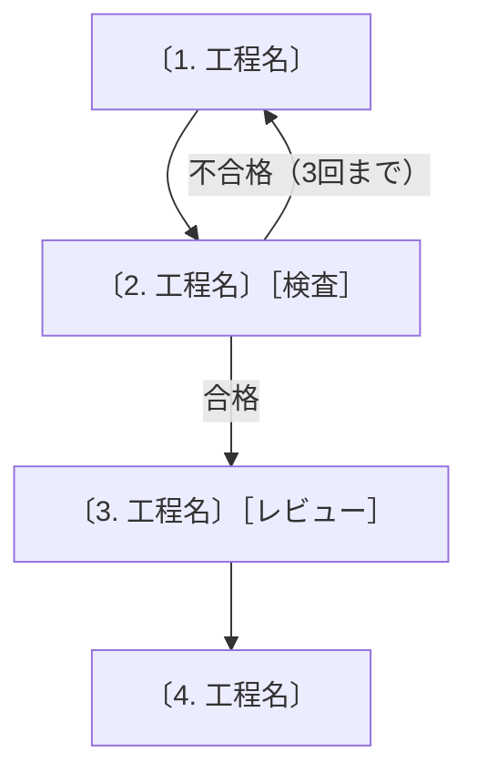

# 開発の進め方（DEV_PLAN）

<!-- ai-driven-dev の作業ファイル。ai-dev/DEV_PLAN.md に置く。コミットしない。
     節の追加・削除をしない（再開時に構造を前提に読む）。〔〕は埋めたら消す。 -->

状態: 聞き取り中
<!-- 聞き取り中 / 提案中 / 合意済み / 生成済み のどれか -->

## 目的

| 項目 | 内容 | 確度 |
|---|---|---|
| 作るもの・変えるもの | 〔例: 在庫管理の社内 Web アプリに CSV 取り込みを足す〕 | 回答 / 仮置き |
| なぜ | 〔例: 手入力に毎週2時間かかっている〕 | |
| 成功の判定 | 〔判定できる文。例: 1万行の CSV を5分以内に取り込め、エラー行が一覧で分かる〕 | |
| 情報のありか | 〔例: 要件は ~/docs/要件.xlsx、既存の仕組みはリポジトリ。無ければ「聞き取りの答えのみ」〕 | |
| 使う人 | 〔例: 自分だけ / 部署の5人 / 社外〕 | |
| 期限・規模の見込み | 〔例: 2週間、画面2つ〕 | |
| 繰り返しの頻度 | 〔例: 同じ種類の改修を月に数回〕 | |
| 使う AI ツール | 〔Claude Code / Codex / Copilot / Antigravity CLI のどれか、複数可〕 | |
| 人が判断したい場面 | 〔例: 画面の見た目、DB のスキーマ変更、外部への送信〕 | |
| 制約 | 〔言語・環境・社外に出せない情報・使えないサービス〕 | |
| 失敗したときの影響 | 〔例: 自分の手戻りだけ / 業務が止まる〕 | |

## 現状診断

〔読んだ入力（設計書・モデル・要求・既存の成果物）の一覧と、足りないもの。リポジトリがあれば survey_repo.py の出力。機械の確認手段（テスト・検査）の有無と、実行したならその結果〕

## 進め方の提案

| # | プラクティス | 採否 | この目的での理由 | トレードオフ・代わりの案 | 出典 |
|---|---|---|---|---|---|
| 〔A1〕 | 〔検証手段を渡す〕 | 〔採用 / 採用しない / 未決〕 | | | 〔S1, S2〕 |

### 任せる範囲

- AI に任せる: 〔〕
- 人が主導する: 〔〕

### 効果の確かめ方

- 〔何を数えるか。例: 1件の改修にかかった時間、手戻りになった指摘の件数〕

## 生成するスキル

| 項目 | 内容 |
|---|---|
| 名前 | 〔例: inventory-app-dev〕 |
| 置き場所 | 〔例: <対象>/.agents/skills/inventory-app-dev/〕 |
| 発火の言い回し | 〔3〜5個〕 |
| 使う既存スキル | 〔例: implementation-plan-grill、ui-visual-verify〕 |
| 記録とコミット | 〔例: ローカルで作業、REVIEW_LOG に記録、コミットしない〕 |

## 作業の流れ（生成するスキル）

<!-- 合意の前に見せる節。生成するスキルはこの節を正本にして作り、生成後のレビューで食い違いを確かめる。
     図の箱には、機械で確かめる工程に「［検査］」、ユーザーのレビューを挟む工程に「［レビュー］」を付ける。
     判定の基準を書ける確認は先に機械（テスト・検査スクリプト）に回し、ユーザーのレビューの範囲を減らす。
     ユーザーが見る工程は、機械で確かめきれない点を書く（見る範囲を絞る手がかりになる）。
     機械の確認が無い工程は「なし（理由）」と書く。 -->

| 工程 | AI がすること | 機械で確かめること（コマンド → 合格の判定） | ユーザーが見るもの（REVIEW_LOG の節） | 機械で確かめきれない点 |
|---|---|---|---|---|
| 〔1. 工程名〕 | 〔〕 | 〔例: `pytest -q` → 終了コード 0。無ければ「なし（画面の見た目だけの変更）」〕 | 〔例: オプション名の候補（R2）。無ければ「なし」〕 | 〔例: 名前の好みは基準を書けない。無ければ「なし」〕 |

## 未決事項

- 〔項目と仮置きした答え。無ければ「なし」〕

## 経緯

- 〔YYYY-MM-DD 作成〕
